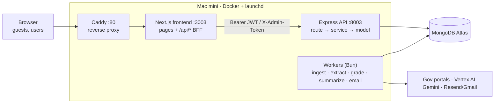

# Architecture

**The browser only talks to Next.js. Next.js calls this API server-side, and
only the API and the workers touch MongoDB.** Workers are separate processes
that hand work to each other through Mongo queue collections, never through
function calls, so a stage can crash or be re-run without the others noticing.



Only Caddy is reachable from outside. The frontend reaches the API on the
shared Docker network `bangkoktor-net` at `http://backend:8003`.

## Tech stack

| Layer | Choice | Notes |
|---|---|---|
| Runtime | Bun 1.x, TypeScript strict, no build step | `bunfig.toml` preloads `src/bun-shims.ts` (bson/v8 workaround) |
| HTTP | Express 5.2 | Validation, JWT check, CORS and rate limiting are hand-written; no zod or passport |
| Database | MongoDB (Atlas in prod, `mongo:7` locally), Mongoose 9.9 | Indexes declared in schemas; no migrations |
| PDF / text | `@opendataloader/pdf` (starts a JVM per call) | About 69% of TOR PDFs are scans, so OCR is the main path |
| AI | Vertex AI `gemini-2.5-flash` (express-mode key) | Legitimacy grading and summaries |
| Email | Resend or Gmail SMTP; console fallback | Match digests |
| Tests | `bun test` | Unit `*.test.ts` + branch checks in `checklist/` |

## How a request is authenticated

| Gate | Used by | How | On failure |
|---|---|---|---|
| **Public** | Guests | No token. `tor.serialize.ts` strips the private grade, rule findings and raw summary from every public response (FR-19) | — |
| **User** — `requireUser` | Signed-in users, via the frontend server | The frontend signs a 60-second HS256 JWT with `INTERNAL_JWT_SECRET` (`sub` = Google id, `email`) and sends `Authorization: Bearer …`. The backend finds or creates the user and sets `res.locals.userId` / `role`. `requireRole("admin")` adds a role check | 401, or 403 for the wrong role |
| **Admin token** — `X-Admin-Token` | Frontend server (admin actions, `user/sync`), the capture extension | Shared secret `ADMIN_TOKEN`, never sent to a browser | **404**, so the route isn't revealed. Open in dev if unset; production won't boot without it |

The user id always comes from the token, never from the URL or body (NFR-08).

## Code layout

```
index.ts                  entry → src/server.ts (config check, Mongo, seed skills, listen)
src/app.ts                middleware chain
src/routes/index.ts       mounts every module router
src/middleware/           adminToken, cors, errors, limits, rateLimit, requestLog, requireRole, requireUser
src/modules/<feature>/    *.route → *.controller → *.service → *.model (+ *.validation)
src/lib/                  sources/, classify/, extract/, grade/, ai/, mail/, http/, thai/, similar/, skills/
src/*.ts                  worker processes and CLI scripts (see setup.md)
tools/egp-capture/        Chrome extension that posts to /api/ingest/capture
checklist/                per-branch wiring tests
```

Modules: `tor`, `me`, `user`, `notification`, `techstack`, `bookmark`,
`ingest`, `extract`, `grade`, `monitor`, `budget`, `match`, `bidding`. Copy
`src/modules/_template/` to start a new one (it isn't mounted).

### Layer rules

| Layer | Does | Never |
|---|---|---|
| Route | Map path → handler, attach middleware | Logic |
| Controller | Parse input, call **one** service, set status | try/catch (errors bubble to `errorHandler`) |
| Service | Business logic on plain arguments | See `req` / `res` |
| Validation | Turn `unknown` into typed input or throw 400 | Touch the DB |
| Model | Schema and indexes | Logic |

Middleware order in `src/app.ts`: request log → CORS allowlist
(`CORS_ORIGINS`) → JSON body (2 MB on `/api/ingest/capture`, 100 KB elsewhere)
→ routes → 404 → error handler (`{error}`; a generic 500 in production).

## Ingestion pipeline

| # | Stage | Run by | Reads → writes |
|---|---|---|---|
| 1 | Discover | `bun run discover` (launchd 06:00 and 18:00), `POST /api/ingest/run`, or the capture extension | BMA e-GP, govspending, CKAN → `ingest_queue`, `ingest_runs`, `watermarks` |
| 2 | Fetch documents | `bun run worker` | `ingest_queue` → `tors`, `documents`, `ingest_errors` |
| 3 | Extract text | `bun run extract-worker` | `extraction_queue` → `tor_texts` |
| 4 | Grade | `bun run grade-worker` or `POST /api/grade/run` | `tor_texts` → `tors.grade`, `ruleFindings` |
| 5 | Summarize | `bun run summarize-worker` | `tor_texts` → `tors.summaryBullets` |
| 6 | Notify | `bun run email-worker` | pending `notifications` → email |

- Every call to a government host goes through `src/lib/http/politeClient.ts`
  (honest User-Agent, delay, timeout, backoff), per NFR-07.
- Workers claim queue rows with a lease and write heartbeats to
  `worker_heartbeats`; the admin pipeline page reads both.
- Stages 3–6 are started by hand today. Nothing queues extraction automatically
  after a fetch.

Three facts about the sources shape the design:

1. **The portals can't tell you what changed**, so incremental ingest is our own
   state in `watermarks`.
2. **Most TOR PDFs are scans**, so we triage each document as
   `digital` / `scanned` / `unreadable` when we fetch it.
3. **CKAN rows are shifted against their header** (32 declared columns, 29
   values). The CKAN adapter realigns them, and tests pin that behaviour.

Next: [setup.md](setup.md)
