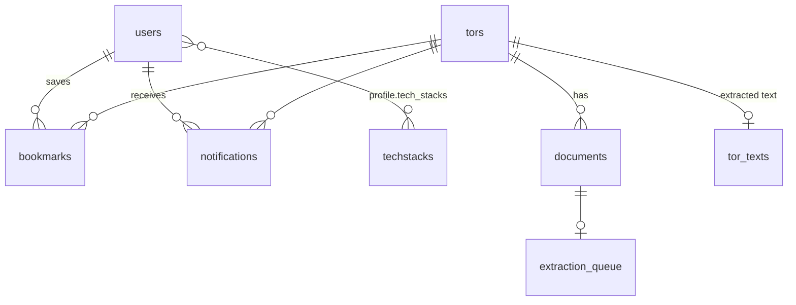
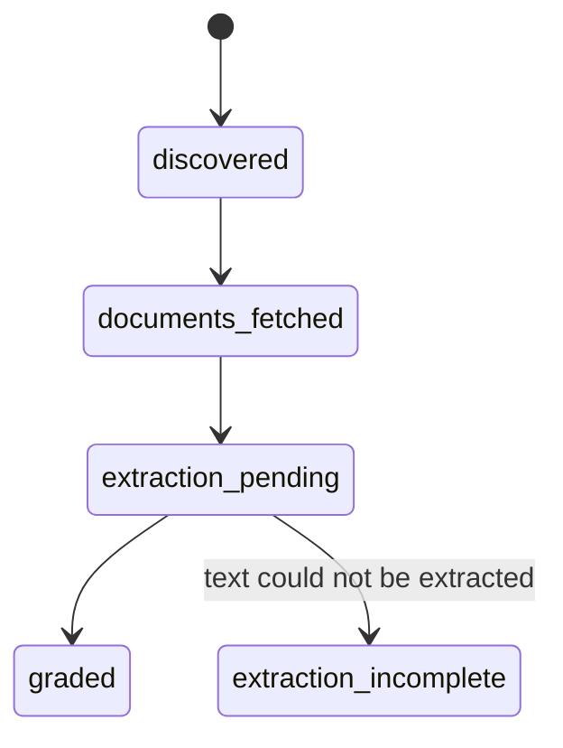

# Data model

MongoDB, with 15 collections defined as Mongoose models next to the module
that owns them. `tors` is the centre: documents, texts, bookmarks and
notifications all point at it.

- **No migrations.** Indexes are declared in each schema.
- **Seed data:** the skill vocabulary (about 60 tech stacks) is seeded at boot
  by `ensureSkillVocabulary`.
- **Data fixes** are CLI scripts (`backfill-*`, `purge-out-of-scope`, …). Run
  `backup-collections` first.

## Users and personalisation

| Collection | Model | Key fields | Unique / relations |
|---|---|---|---|
| `users` | `modules/user/user.model.ts` | `google_id`, `email`, name fields, `role` (admin/client/agency, default client), `profile{skills, team_size_band, duration, concurrent, budget_min/max, work_types, notify{…}, tech_stacks[]}` | unique `email`; unique sparse `google_id` |
| `techstacks` | `modules/techstack/techstack.model.ts` | `name`, `slug`, `category` | unique `name`, unique sparse `slug` |
| `bookmarks` | `modules/bookmark/bookmark.model.ts` | `userId`, `torId`, `createdAt` | unique {userId, torId} |
| `notifications` | `modules/notification/notification.model.ts` | `user_id`, `tor_id`, `title`, `message`, `is_read`, `fit_score`, `email_status` (pending/sent/failed/skipped) | unique {user_id, tor_id} |

## TORs and their documents

| Collection | Model | Key fields | Unique / relations |
|---|---|---|---|
| `tors` | `modules/tor/tor.model.ts` | See below | unique {sourceId, projectId}, plus about 14 query indexes |
| `documents` | `modules/ingest/document.model.ts` | `kind` (announcement/tor/bundle/extractedPdf), `url`, `sha256`, `localPath`, `textLayer` (digital/scanned/unreadable/missing) | → tors; unique {sourceId, projectId, externalId} |
| `tor_texts` | `modules/extract/torText.model.ts` | `fullText`, `chars`, `truncated`, `files[]` page ranges | → tors (one each), documents |

The main `tors` field groups:

| Group | Fields |
|---|---|
| Identity | `sourceId`, `projectId`, `projectName`, `agency`, `department` |
| Money and type | `budget`, `procurementMethod`, `category`, `workTypes`, `isSoftware` |
| Time and place | `fiscalYear` (BE), `announcedAt`, `province`, `district`, `location` (GeoJSON) |
| Bidding | `biddingStage`, `bidOpensAt`, `bidClosesAt`, `deadlineEvidence` |
| **Private** (never public, FR-19) | `grade` (A/B/C), `gradeScore`, `ruleFindings[]` |
| Derived | `summaryBullets[]`, `requiredSkills[]`, `legitimacySignals`, `signalCount` |
| Lifecycle | `status`, `statusReason`, `sourceUrl`, `fetchedAt` |

## Pipeline bookkeeping

| Collection | Holds |
|---|---|
| `ingest_queue` | One row per project to fetch. `status` is pending / working / done / failed, with a claim lease (`claimedBy`, `claimedAt`) and `attempts` |
| `extraction_queue` | One row per bundle to extract, with the same claim pattern plus digital/scanned counts |
| `ingest_runs` | Each discover / fetch / capture run, with its counts and outcome |
| `ingest_errors` | Every failure with its URL and message (FR-06); retried from the admin page |
| `watermarks` | Resume point per source. The portals can't say what changed, so we track it |
| `worker_heartbeats` | Live / stale / dead state per worker |
| `budget_lines`, `budget_imports` | Bangkok budget workbooks per BE year |

## TOR status lifecycle

- `extraction_incomplete` is a dead end on purpose: we never publish partial
  data (FR-11).
- `published` exists in the enum, but nothing writes it yet.
- In production the public API shows `graded`, `published`,
  `documents_fetched` and `extraction_pending`. `LIST_ALL_TORS` overrides this.
