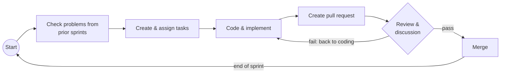
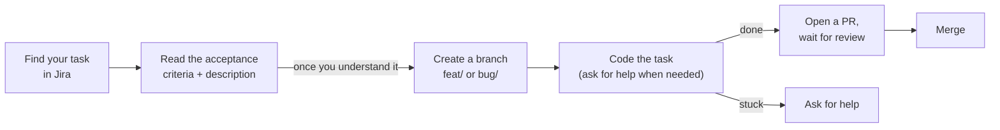

# How we work

> Shared file, identical in the backend and frontend repos. Change both.

**We work in sprints tracked in Jira.** Each sprint opens with a meeting, turns
functional requirements (FRs) into tickets with acceptance criteria, and ends
when the reviewed work is merged.

## 1. The sprint loop

Each sprint starts by looking at what broke, slipped or got blocked last time,
before anything new is planned. A PR that fails review goes back to coding with
the reviewer's comments.

## 2. Creating a task

1. **Check the FR.** Start from the SRS requirement the task serves (FR-01 to
   FR-24, NFR-01 to NFR-10).
2. **Discuss the task and define it clearly in Jira**, so that finishing it
   meets the need of that FR.
3. **Write the acceptance criteria.** These testable conditions decide "done"
   in review and in UAT.

A ticket is ready to pick up when it has:

| Field | Example |
|---|---|
| Title, verb first | Filter TOR list by bid-closing date |
| FR | FR-13 |
| Who needs it and why | A team wants to hide tenders that close before they could prepare a bid |
| Acceptance criteria (Given / When / Then) | Given TORs closing on 1 and 20 Dec, when I set "closes after 10 Dec", then only the 20 Dec TOR shows |
| Repo(s) | frontend + backend |
| Assignee | One person |

## 3. Doing a task

- Don't start until you understand the acceptance criteria. If anything is
  unclear, ask in the ticket.
- Being stuck for more than half a day is the signal to ask, not a failure.
  Post in the team chat and raise it at the next meeting, so the ticket can be
  split or reassigned.
- Merge order: `QA` first, then `main` after UAT ([workflow.md](workflow.md)).

Next: [pull-requests.md](pull-requests.md)
