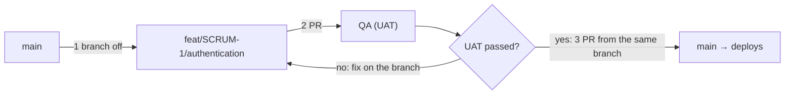

# Git workflow

> Shared file, identical in the backend and frontend repos. Change both.

**Every change starts as a branch off `main`, goes to `QA` for user acceptance
testing, then goes to `main` (production).** Merge the *feature branch* into
each of them, and never merge `QA` into `main`. That way a feature that fails
UAT, or is still waiting for it, can't ride into production on someone else's
merge.

| Branch | Lives | Purpose | Merged into it |
|---|---|---|---|
| `main` | Forever | Production. Every push deploys | Branches that passed UAT, and hotfixes |
| `QA` | Forever | UAT: the team checks acceptance criteria here | Feature and bug branches |
| `feat/…`, `bug/…` | Until merged to `main` | One Jira ticket each | Only its author pushes |

> **Not set up yet:** the `QA` branch has to be created from `main` in both
> repos and protected like `main`, and it needs its own deploy (see
> [deployment.md](../deployment.md)). Until then, PRs go straight to `main`.

## Step by step

1. `git switch main && git pull`
2. `git switch -c feat/SCRUM-123/tor-deadline-filter`
3. Commit as you go. Push and open a **draft PR into `QA`** early so others can
   see it.
4. When the acceptance criteria are met, mark the PR ready. After review it
   merges into `QA` and is tested there.
5. Once UAT passes, open a PR from the **same branch** into `main`.
6. Delete the branch and move the Jira ticket to Done.

If `main` moves while you work, update your branch with `git merge main`, or
`git rebase main` if nobody else has pulled your branch. Never update it from
`QA`.

## Branch names

The pattern is `<type>/<jira-key>/<short-slug>`: lowercase slug, words joined
by dashes.

| Type | Use for | Example |
|---|---|---|
| `feat` | A feature or user story | `feat/SCRUM-116/graph-dashboard` |
| `bug` | A defect found in QA or by a user | `bug/SCRUM-140/deadline-off-by-one` |
| `hotfix` | An urgent production fix (below) | `hotfix/SCRUM-142/login-loop` |
| `refactor`, `test`, `chore` | No behaviour change | `test/SCRUM-137/add-tests` |

Use the full Jira key (`SCRUM-116`, not `116`) so Jira links the branch and PR
to the ticket. The older prefixes `fix/` and `patch-NN/` are folded into `bug/`
and `hotfix/` from now on.

## Hotfix flow

A hotfix skips UAT, so use it only when production is broken **now**.
Everything else is a `bug/` branch through the normal flow.

- **Counts as a hotfix:** the site or sign-in is down; the TOR list or detail
  page errors for everyone; private data (a grade, another user's data) is
  leaking; a worker is corrupting data.
- **Not a hotfix:** wrong styling, a filter edge case, anything with a
  workaround.

1. Create a Jira ticket with priority **Highest** and tell the team in the group chat.
2. `git switch main && git pull && git switch -c hotfix/SCRUM-142/login-loop`
3. Make the smallest change that stops the damage. Run typecheck and tests locally.
4. Open a PR into `main` titled `hotfix: …`. **One** reviewer, within the hour.
5. Merge, then check production: `/health/ready`, then the page that was broken.
6. The same day, open a PR from the same branch into `QA`, so later merges don't
   bring the bug back.
7. If the real fix needs more work, open a normal `bug/` ticket for it.

If the hotfix makes things worse, see [Rolling back](../deployment.md#rolling-back).

Next: [process.md](process.md)
